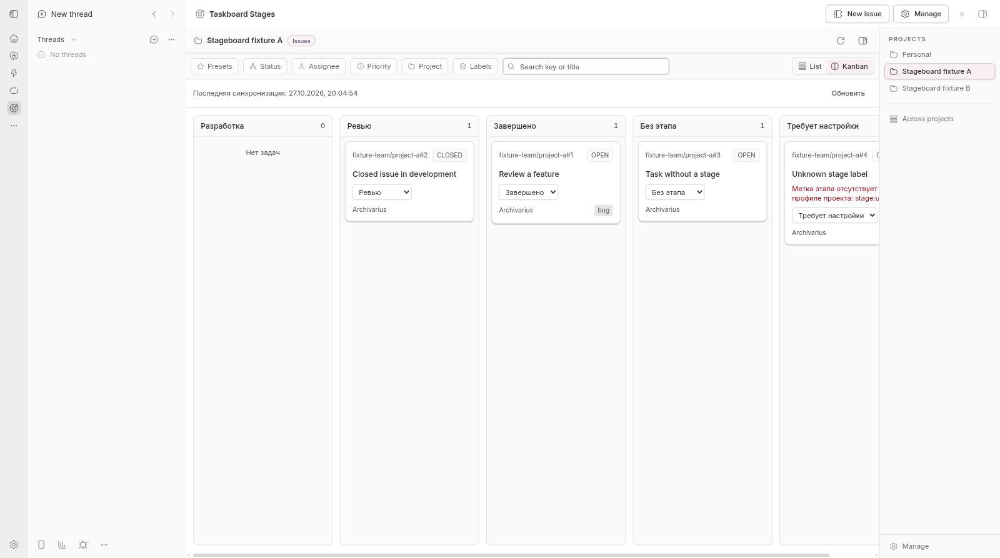
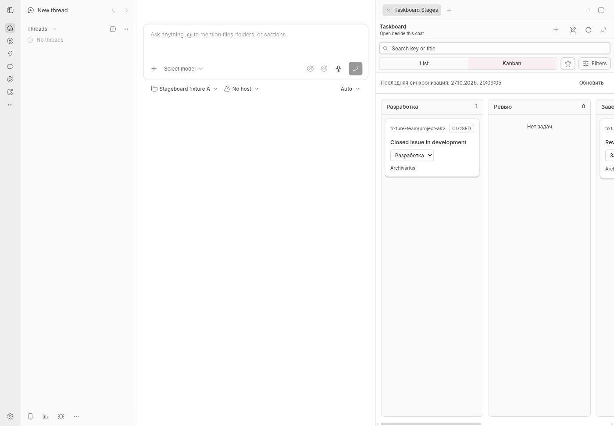

# Taskboard Stages

[Русская документация](README.ru.md) · [Changelog](CHANGELOG.md) · [Contributing](CONTRIBUTING.md)

Project Kanban boards inside **BB**, with columns driven by GitHub issue labels.
Move an issue to a new stage without changing whether it is open or closed.

This is a fork of [Taskboard by Mateo Cerquetella](https://github.com/MateoCerquetella/bb-plugins),
focused on a lightweight workflow for developers and their coding agents.
Each BB project has its own ordered columns. GitHub Projects and a separate
tracking service are not required.



## What it does

- A `stage:*` label determines the column; GitHub Open/Closed remains separate.
- Keep a closed issue in Development or an open issue in Done when the workflow needs it.
- Move cards with drag-and-drop, an accessible stage menu, or the agent CLI.
- Use the full board page or the compact panel beside chat.
- Configure, reorder, export and import columns separately for each project.
- See issues without a stage and issues with conflicting or unknown stage labels.
- Preserve ordinary labels and other issue fields when moving a card.
- Read all issue pages and show synchronization errors and the last successful sync.

The existing Taskboard features remain available. Its optional autonomous
factory is disabled by default; reading the board and moving stages do not
start coding agents or infer progress from CI, merges or completed agent turns.

## Requirements

- BB **0.47.1+**, with a compatible Plugin SDK runtime; tested with SDK **0.6.79**.
- A BB project with a GitHub repository remote.
- The GitHub CLI, authenticated for `github.com`; issue write access is needed
  to change labels and issue states.
- Node.js **22.19+** for building from source; CI uses Node.js 26.

The UI inherits Taskboard's layout. Stage-specific messages and defaults are
currently in Russian; column titles are configurable.

## Install

Install directly from GitHub:

```bash
bb plugin install git:https://github.com/VyacheslavTeplyakov/bb-taskboard-stages.git@v0.1.1
```

To follow compatible 0.1 releases, use `@^0.1.0` instead. The plugin id is
`taskboard-stages`, its display name is **Taskboard Stages**, and its CLI is
`bb stageboard`.

If you already use the original Taskboard, you can disable it and use this fork
as its replacement:

```bash
bb plugin disable taskboard
```

Disabling preserves the original plugin's data. This fork uses its own storage;
it does not automatically migrate the original plugin's settings or credentials.
GitHub authentication continues to use the existing `gh` login.

## Set up a project

Ask an agent in the target BB project: **“Set up Taskboard Stages for this
project.”** The bundled `stageboard-setup` skill checks the connection, agrees
on columns and responsibilities, applies configuration and records project
instructions. It works with a human, one agent or your existing roles.
See [project onboarding](docs/ONBOARDING.md) for the workflow and readiness checks.

For manual setup:

1. Open **Taskboard Stages** and select a BB project.
2. In **Manage**, confirm GitHub as the tracker and check the mapped repository.
3. Under **Этапы GitHub-канбана**, set column titles, labels and their order.
   **Пример этапов** fills an editable example; save to apply the profile.
4. Use **Проверить метки** to check repository labels. If labels are missing,
   **Создать отсутствующие метки** explicitly creates them.
5. Switch to **Kanban** and move cards with the stage menu or drag-and-drop.

Saving or importing a profile does not write to GitHub. Creating repository
labels does not modify issues. An empty profile keeps the standard Taskboard
view. Issues without a stage appear in **Без этапа**; unknown or multiple stage
labels appear in **Требует настройки** until an explicit stage assignment fixes them.

Open/Closed has its own filter and control. External GitHub changes appear on
the next synchronization or manual refresh. Changes through this plugin notify
the board after confirmation.

## Agent workflow

The bundled [stageboard skill](skills/stageboard/SKILL.md) documents the agent
interface. Always use an explicit BB project:

```bash
bb stageboard stages profile --project <project-id> --json
bb stageboard stages list --project <project-id> --json
bb stageboard stages options 'owner/repo#42' --project <project-id> --json
bb stageboard stages move 'owner/repo#42' stage:review --project <project-id> --json
```

`stages list` returns a bounded page, revision and `nextOffset`. Follow the
continuation instructions in the skill to read the entire board consistently.
`stages prepare` is the separate, explicit command for creating missing labels.

The project's recorded workflow decides who maintains the board and what
evidence permits each transition. The human UI and agents use the same stage
operation. A stage write rechecks current labels, updates individual stage
labels and verifies the result. On a conflict or an uncertain response, refresh
before retrying. GitHub's separate label calls do not form one transaction.



## Develop and update

```bash
git clone https://github.com/VyacheslavTeplyakov/bb-taskboard-stages.git
cd bb-taskboard-stages
npm ci
npm run check
```

The checks cover SDK types, TypeScript, 345 automated tests, server/app/host
builds and bundle metadata. Tests use fixtures and do not require GitHub
credentials. The first release was also checked in an isolated BB with real
GitHub writes, native drag-and-drop, conflicts and restart recovery.

See [CONTRIBUTING.md](CONTRIBUTING.md) for the upstream update workflow. The
default development branch is `taskboard-stages`; upstream `main` retains the
original multi-plugin layout.

## Provenance and license

MIT. Original copyright and third-party notices are retained in
[LICENSE](LICENSE) and [THIRD_PARTY_NOTICES.md](THIRD_PARTY_NOTICES.md).

Base: Taskboard **0.3.6**, tag `taskboard/v0.3.6`, commit
`2dcad8a23bd06121b5c42faaf7ea0716f24b4915`. The fork preserves upstream history
and separates extraction, implementation and publication commits.
`UPSTREAM.json` records source hashes; `UPSTREAM-README.md` and
`UPSTREAM-package-lock.json` preserve upstream documentation and the original
monorepo lockfile. The current `package-lock.json` pins this standalone package.
See [AUTHORS.md](AUTHORS.md) for attribution.
